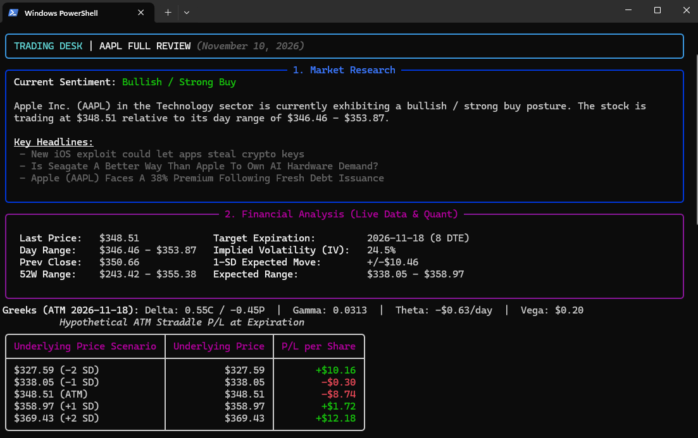
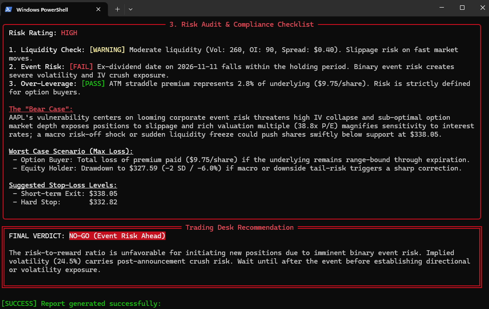

# TradingDesk: Offline Algorithmic Stock Review Engine

[](https://www.python.org/downloads/)
[](https://github.com/Samuel-89/TradingDesk)
[](https://docs.pytest.org/)
[](LICENSE)

**TradingDesk** is a deterministic, offline algorithmic stock analysis and risk audit engine built in Python 3.14.3. It replaces runtime LLM prompts with pure quantitative models, real-time market data ingestion, and rigorous risk checklists—providing an institutional-grade full-desk review of any equity ticker in seconds.

---

## Visual Preview (v1 in Action)

The tool renders a live, color-coded terminal dashboard and simultaneously exports a detailed Markdown report to the `reports/` folder.

| Market Research & Financial Analysis | Quant P/L, Risk Audit & Verdict |
| :---: | :---: |
|  |  |

---

## Core Capabilities: The Three Desk Roles

TradingDesk coordinates three specialized roles in a deterministic pipeline:

```mermaid
flowchart TD
    subgraph DataIngestion["1. Data Ingestion Layer"]
        MD[yfinance FastInfo & Fundamentals]
        OD[Options Chain: Strikes, IV, Volume & Spreads]
        ND[Yahoo Finance Live RSS Headlines]
    end

    subgraph Analytics["2. Offline Quantitative & Risk Engines"]
        direction TB
        RE["Market Researcher\n• Lexicon sentiment scoring\n• Catalyst & corporate driver synthesis"]
        QE["Quantitative Analyst (Quant)\n• Analytical Black-Scholes Greeks\n• 1-SD Expected Move\n• Expiration P/L table (-2σ to +2σ)"]
        RO["Risk & Compliance Officer\n• 3-part checklist: Liquidity, Event Risk, Leverage\n• Synthesized 'Bear Case' & worst-case drawdown\n• Dynamic Stop-Loss levels & GO / NO-GO verdict"]
    end

    subgraph Output["3. Presentation Layer"]
        CLI[Rich Interactive Terminal UI]
        MD_EXP[Markdown Report Exporter: reports/{TICKER}_analysis.md]
    end

    DataIngestion --> Analytics
    Analytics --> Output
```

1. **Market Researcher** ([`tradingdesk.research`](file:///src/tradingdesk/research)):
   - Ingests real-time company news via Yahoo Finance RSS.
   - Evaluates offline financial sentiment using headline lexicon dictionaries, Wall Street recommendation keys, and 52-week price channels.
   - Synthesizes market drivers and upcoming corporate catalysts.

2. **Mathematical Analyst / Quant** ([`tradingdesk.quant`](file:///src/tradingdesk/quant)):
   - Extracts live pricing, ranges, and target expiration options chains ($\sim 8$ DTE).
   - Computes closed-form analytical **Black-Scholes-Merton Greeks**: $\Delta$ (Call/Put), $\Gamma$, daily $\Theta$ decay (Call, Put, Straddle), and $\nu$ (Vega).
   - Calculates $1\sigma$ Expected Move: $EM = S \times IV \times \sqrt{\frac{DTE}{365}}$ and ATM straddle pricing.
   - Builds a 5-point expiration P/L matrix across $-2\sigma$, $-1\sigma$, $ATM$, $+1\sigma$, and $+2\sigma$.

3. **Risk & Compliance Officer** ([`tradingdesk.risk`](file:///src/tradingdesk/risk)):
   - **Liquidity Check:** Audits ATM volume, open interest, and bid-ask spread tightness ($\le 15\%$ of mid).
   - **Event Risk:** Flags binary events (earnings releases, ex-dividend dates) within the target holding period ($\le DTE$ days).
   - **Over-Leverage:** Assesses straddle cost percentage and downside exposure.
   - **The "Bear Case":** Synthesizes specific vulnerabilities (valuation multiples, beta, macro shock sensitivity).
   - **Worst-Case Loss Scenarios:** Computes max loss for option buyers (100% premium) and equity holders ($-2\sigma$ drawdown).
   - **Stop-Loss Guidance:** Establishes Short-term Exit ($-1\sigma$) and Hard Stop ($-1.5\sigma$) levels.
   - **Final Verdict:** Automated evaluation yielding `GO`, `CAUTION`, or `NO-GO` with detailed rationale.

---

## How to Install & Run the Tool

### 1. Prerequisites
- **Python 3.14.3** installed on your system.
- Git.

### 2. Setup & Virtual Environment
Clone the repository and set up the virtual environment:
```powershell
# Clone the repository
git clone https://github.com/Samuel-89/TradingDesk.git
cd TradingDesk

# Create and activate virtual environment
python -m venv .venv
.\.venv\Scripts\Activate.ps1

# Install dependencies and editable package
pip install -r requirements.txt
pip install -e .
```

---

### 3. Usage & CLI Commands

#### Quick Start with `main.py`
Run an immediate analysis on any stock ticker:
```powershell
python main.py MSFT
```

#### Interactive Prompt
If you run without arguments, the CLI will prompt you for a ticker:
```powershell
python main.py
# Enter stock ticker symbol (e.g. MSFT, AAPL): AAPL
```

#### Global Console Command
Once installed in editable mode (`pip install -e .`), you can invoke the CLI directly:
```powershell
tradingdesk NVDA
```

#### Custom Reports Directory
By default, markdown reports are saved to `./reports/{TICKER}_analysis.md`. You can customize the destination folder using `-r` or `--reports-dir`:
```powershell
python main.py TSLA -r ./custom_reports
```

---

## Generated Reports

Every execution outputs the full review to the terminal and persists a markdown report in [`reports/`](file:///reports):
```
reports/
├── AAPL_analysis.md
├── MSFT_analysis.md
└── NVDA_analysis.md
```

Each generated file matches the institutional desk format:
- **`## Market Research`**: Current sentiment rating, narrative summary, and top headline drivers.
- **`## Financial Analysis`**: Live market stats, $1\sigma$ expected move, ATM Greeks, and expiration payoff table.
- **`## Risk Audit`**: Compliance checklist statuses, synthesized Bear Case, worst-case loss numbers, stop-loss levels, and the final `GO / NO-GO` recommendation.

---

## Running the Automated Test Suite

TradingDesk includes comprehensive unit tests verifying data models, quantitative math, risk rules, and report generation:

```powershell
pytest
```

Output:
```text
tests\test_data_and_models.py .................  [41%]
tests\test_quant.py .........                    [63%]
tests\test_reporters.py .....                    [75%]
tests\test_risk.py .........                     [97%]
tests\test_skeleton.py .                         [100%]
====================== 41 passed in 2.14s ======================
```

---

## Directory Structure

```
TradingDesk/
├── media/                         # Application screenshots & assets
│   ├── v1_1.png
│   └── v1_2.png
├── reports/                       # Generated Markdown reports
│   └── .gitkeep
├── src/
│   └── tradingdesk/
│       ├── __init__.py
│       ├── cli.py                 # Typer + Rich CLI interface
│       ├── config.py              # Risk thresholds & quant parameters
│       ├── engine.py              # Master 3-role desk orchestrator
│       ├── data/                  # Market data, options chain & news RSS fetchers
│       ├── models/                # Pydantic schemas (Quote, Greeks, Risk, Report)
│       ├── quant/                 # Black-Scholes-Merton, Expected Move, P/L matrix
│       ├── reporters/             # Rich terminal renderer & Markdown generator
│       ├── research/              # Headline sentiment & catalyst synthesis
│       └── risk/                  # Checklist audit, Bear Case & verdict engine
├── tests/                         # Pytest test suite (41 tests passing)
│   ├── test_data_and_models.py
│   ├── test_quant.py
│   ├── test_reporters.py
│   ├── test_risk.py
│   └── test_skeleton.py
├── main.py                        # Root convenience runner
├── pyproject.toml                 # Package metadata & entry points
├── requirements.txt               # Pinned production dependencies
├── requirements-dev.txt           # Testing & linting tools
└── README.md                      # Documentation & user guide
```

---

## Complete Version History & Changelog

### **v1.0.0 (2026-11-10) — Sprint 4: Full MVP Launch**
* **Presentation Layer & Orchestrator:**
  - Implemented master desk orchestrator [`tradingdesk.engine.run_desk_review`](file:///src/tradingdesk/engine.py) seamlessly coordinating Market Research, Quant, and Risk Audit into a single pipeline.
  - Built interactive terminal dashboard with [`rich`](https://github.com/Textualize/rich) featuring styled panels, status badges, metrics grids, and payoff tables.
  - Added Windows-safe console rendering (`UTF-8` reconfiguration with safe ASCII bullet and badge fallbacks).
  - Built markdown report exporter generating identical reports to target institutional specifications in [`reports/{TICKER}_analysis.md`](file:///reports).
  - Created Typer CLI interface in [`tradingdesk.cli`](file:///src/tradingdesk/cli.py) and root runner [`main.py`](file:///main.py) with animated status spinners and interactive ticker prompt.
  - Added end-to-end integration tests in [`tests/test_reporters.py`](file:///tests/test_reporters.py), bringing total automated test count to **41 passing tests**.
  - Merged feature branch `sprint-4-cli-reporting` into `dev` and released `v1.0.0-mvp` on `main`.

### **v0.4.0 (2026-11-10) — Sprint 3: Risk & Compliance Officer Audit Engine**
* **Risk & Compliance Engine:**
  - Implemented the critical Risk Officer persona in [`tradingdesk.risk`](file:///src/tradingdesk/risk).
  - Created 3-part compliance checklist:
    - **Liquidity Check:** Evaluates ATM option volume, open interest, and bid-ask spread tightness.
    - **Event Risk Check:** Identifies imminent corporate earnings and dividend ex-dates within target DTE holding windows.
    - **Over-Leverage Check:** Evaluates option premium cost percentage against underlying stock price.
  - Built worst-case loss scenarios (100% loss of straddle premium for option buyers, $-2\sigma$ drawdown for equity holders).
  - Built dynamic stop-loss calculations: Short-term exit ($-1\sigma$) and Hard stop ($-1.5\sigma$).
  - Added automated Bear Case statement synthesis evaluating high P/E multiples, elevated beta, and binary event risks.
  - Added deterministic `GO`, `CAUTION`, and `NO-GO` verdict evaluation with rationale.
  - Added unit test suite in [`tests/test_risk.py`](file:///tests/test_risk.py).

### **v0.3.0 (2026-11-10) — Sprint 2: Quantitative Engine & Market Research Analysis**
* **Quantitative Math & Research:**
  - Implemented analytical Black-Scholes-Merton option pricing and Greeks in [`tradingdesk.quant.black_scholes`](file:///src/tradingdesk/quant/black_scholes.py): Call/Put Delta, Gamma, daily Theta decay, and Vega.
  - Implemented $1\sigma$ Expected Move calculator with straddle pricing blend and range boundaries in [`tradingdesk.quant.expected_move`](file:///src/tradingdesk/quant/expected_move.py).
  - Implemented expiration P/L payoff table across $-2\sigma$, $-1\sigma$, $ATM$, $+1\sigma$, $+2\sigma$ intervals in [`tradingdesk.quant.pnl_table`](file:///src/tradingdesk/quant/pnl_table.py).
  - Implemented offline financial sentiment analyzer using lexicon scoring, recommendation trends, and 52-week position channels in [`tradingdesk.research.sentiment`](file:///src/tradingdesk/research/sentiment.py).
  - Added market context generator in [`tradingdesk.research.context`](file:///src/tradingdesk/research/context.py).
  - Added quantitative unit tests in [`tests/test_quant.py`](file:///tests/test_quant.py).

### **v0.2.0 (2026-11-10) — Sprint 1: Domain Models & Market Data Ingestion**
* **Data Ingestion Layer & Contracts:**
  - Defined strict Pydantic schemas in [`tradingdesk.models`](file:///src/tradingdesk/models) (`MarketQuote`, `Greeks`, `ExpectedMove`, `PnLRow`, `OptionsAnalysis`, `ChecklistItem`, `RiskAudit`, `DeskReport`).
  - Implemented live Yahoo Finance RSS headline fetcher with XML parsing in [`tradingdesk.data.news_data`](file:///src/tradingdesk/data/news_data.py).
  - Built robust `yfinance` market data fetcher with NaN-safe converters and camelCase/snake_case attribute fallbacks in [`tradingdesk.data.market_data`](file:///src/tradingdesk/data/market_data.py).
  - Built options chain parser with automatic target expiration selection ($\sim 8$ DTE) and ATM strike matching in [`tradingdesk.data.options_data`](file:///src/tradingdesk/data/options_data.py).
  - Added comprehensive data and model tests in [`tests/test_data_and_models.py`](file:///tests/test_data_and_models.py).

### **v0.1.0 (2026-11-09) — Sprint 0: Architecture, Packaging & Tooling Baseline**
* **Project Genesis:**
  - Initialized clean Python 3.14.3 virtual environment and package configuration via `pyproject.toml`.
  - Configured project directory structure with package initializers and `.gitignore`.
  - Established git branch workflow with `main`, `dev`, and sprint feature branches.
  - Added initial smoke test suite in `tests/test_skeleton.py`.
